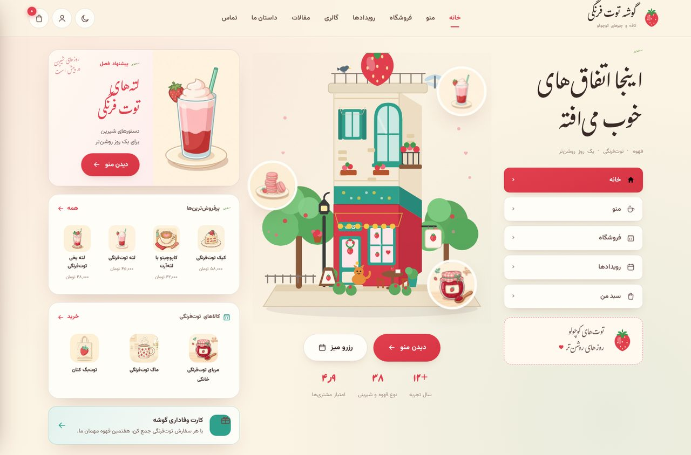
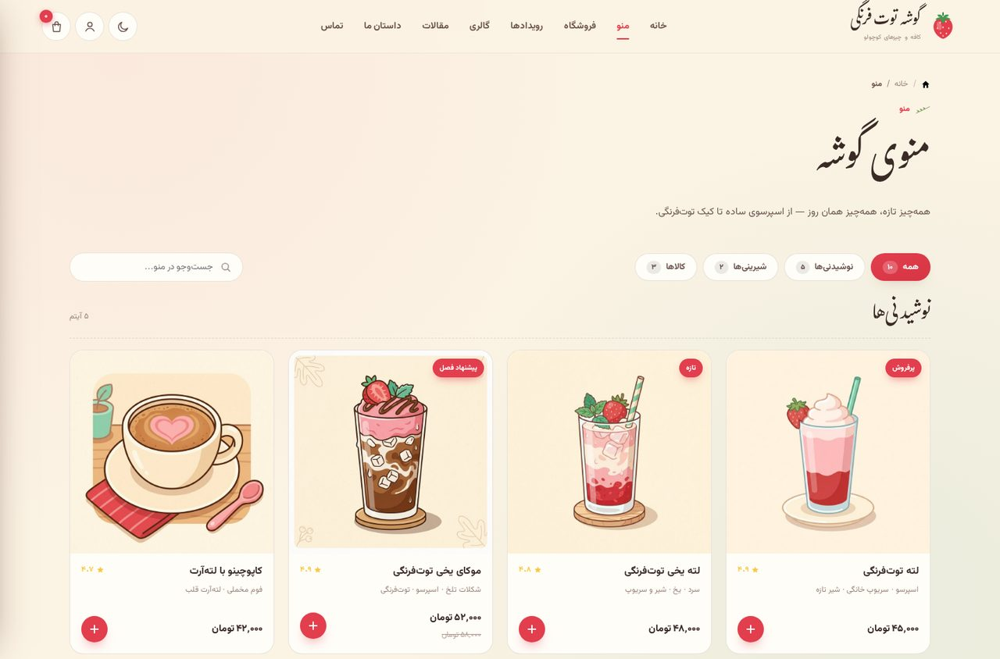
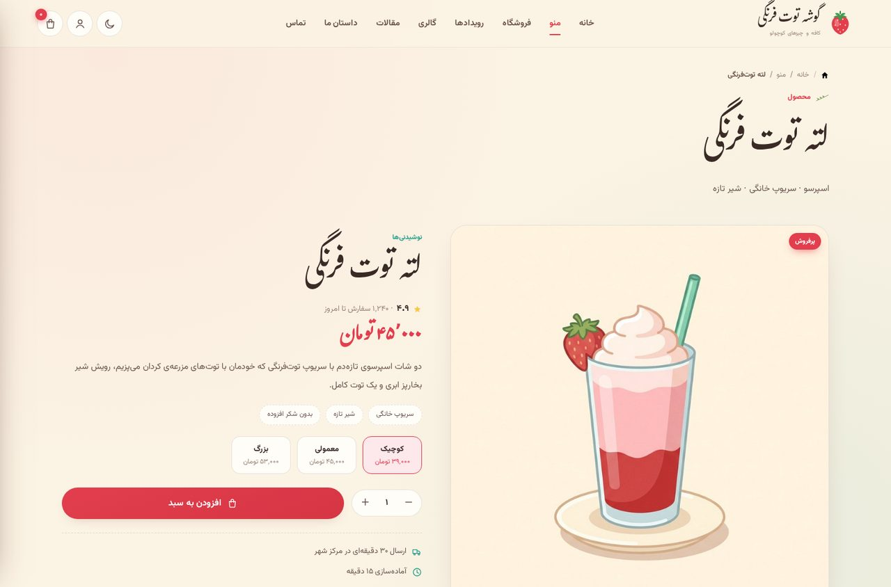
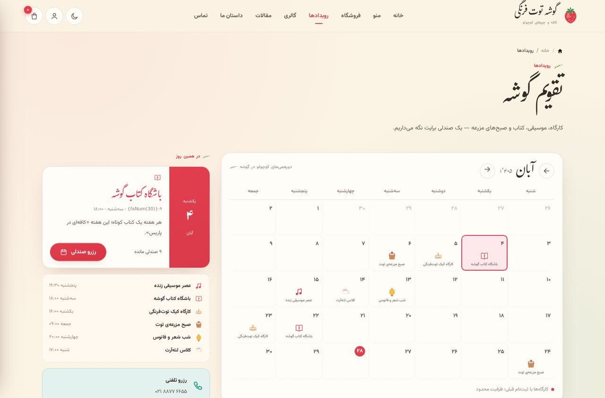
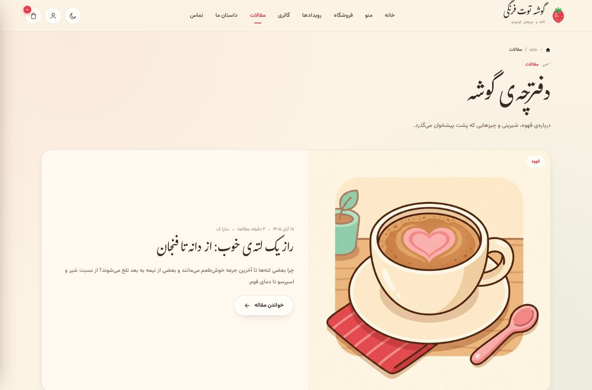
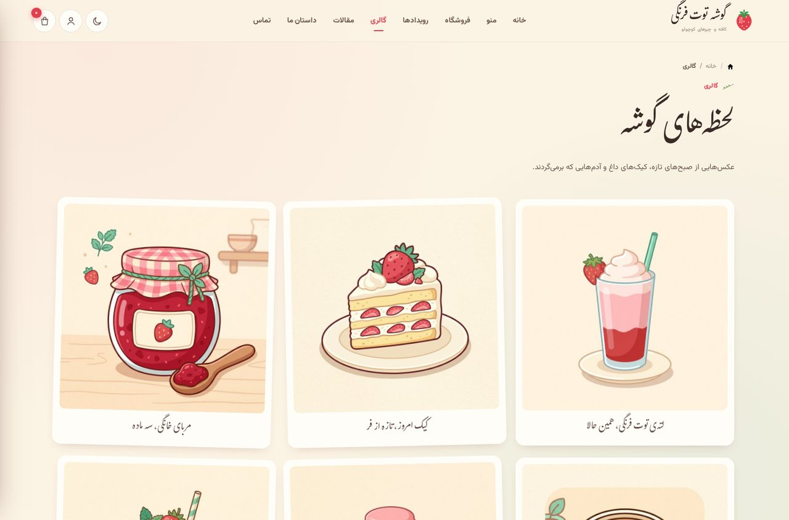
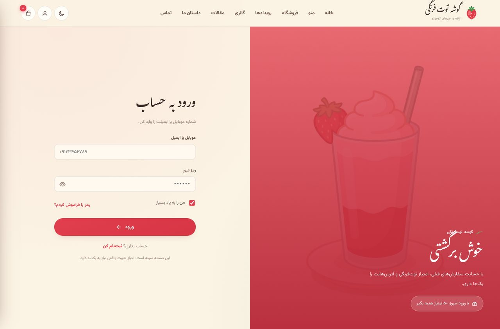
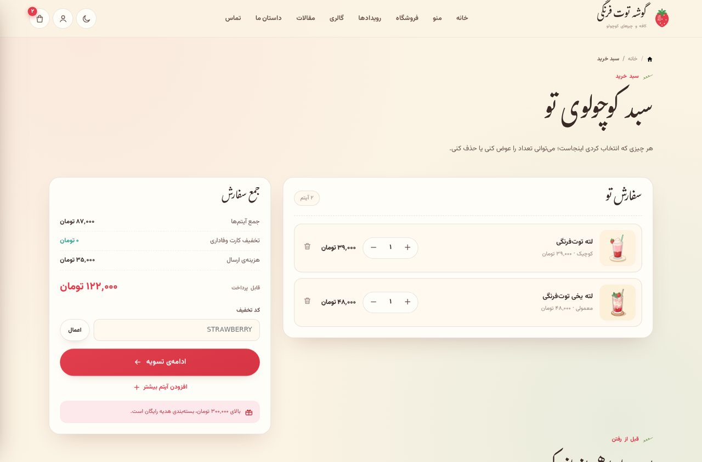
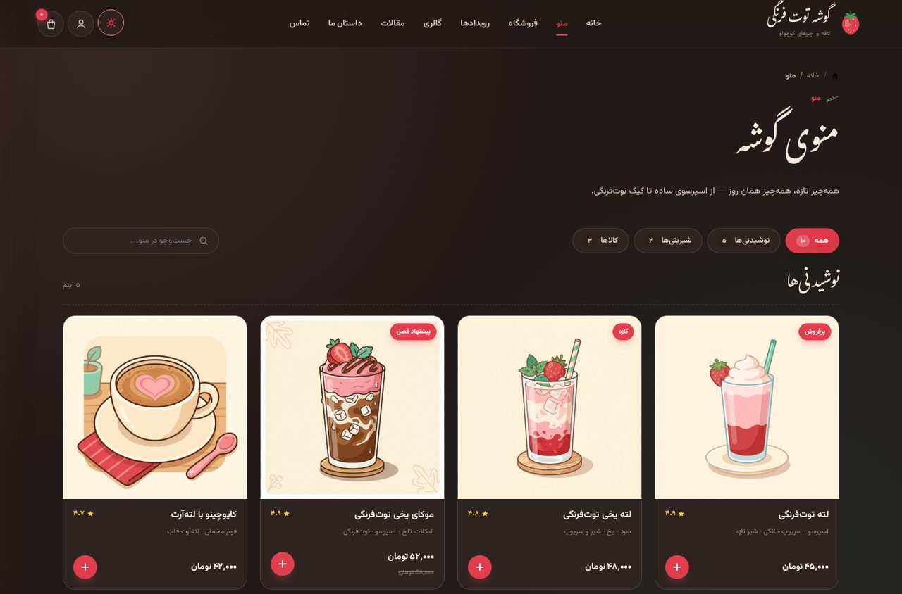
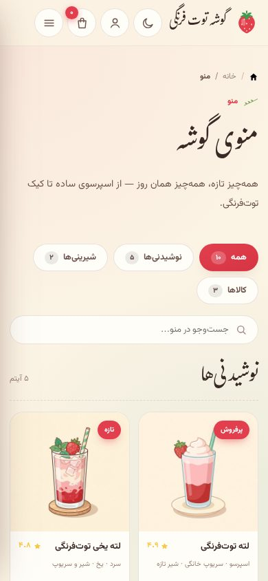

# 🍓 گوشه توت‌فرنگی — قالب کافه (فارسی)

**یک قالب کامل، آماده‌ی تحویل به مشتری: ۳۰ صفحه‌ی مستقل، راست‌چین، فونت فارسی، تقویم شمسی، سبد خرید و انیمیشن.**
HTML + CSS + JavaScript خالص · بدون هیچ وابستگی بیرونی · کاملاً آفلاین

[English](./README.md) · [راهنمای شخصی‌سازی](./docs/CUSTOMIZATION.md) · [تغییرات](./CHANGELOG.md)

---

## پیش‌نمایش

| خانه | منو |
|---|---|
|  |  |

| صفحه محصول | رویدادها (تقویم شمسی) |
|---|---|
|  |  |

| مقالات | گالری |
|---|---|
|  |  |

| ورود | سبد خرید | حالت شب |
|---|---|---|
|  |  |  |

<p align="center">
  
</p>

---

## چرا این قالب؟

اکثر قالب‌های کافه‌ی فارسی یا یک دموی تک‌صفحه‌ای‌اند یا یک قالب وردپرسی. این یکی یک **سایت چندصفحه‌ای واقعی** است: هر صفحه یک فایل HTML مستقل و لینک‌پذیر — بدون AJAX، بدون فریم‌ورک، آماده برای هر هاست استاتیک و قابل اجرا روی شبکه‌ی ملی.

- 🧭 **۳۰ صفحه‌ی مستقل** با لینک واقعی و آدرس یکتا
- 📴 **۱۰۰٪ آفلاین** — GSAP، فونت‌ها و تصاویر همه لوکال
- 🍓 **۱۰ تصویرسازی کارتونی اختصاصی** برای قهوه‌ها، شیرینی‌ها و کالاها
- ✨ **لایه‌ی موشن GSAP** — ترنزیشن بین صفحات، ریویل اسکرول، دکمه‌ی مغناطیسی، تیلت سه‌بعدی، **پرواز محصول به سبد**، کانفتی
- 🧾 **فلوی خرید کامل سمت کلاینت** — سبد، کشوی سبد، استپر، کد تخفیف، تسویه، رسید (ذخیره در `localStorage`)
- 📅 **تقویم شمسی واقعی** با الگوریتم استاندارد، آیکون رویداد، بلیت روز و رزرو با مهر انیمیشنی
- 🌙 **حالت شب**، **راست‌چین کامل**، **ریسپانسیو تا ۳۲۰ پیکسل**، احترام به `prefers-reduced-motion`
- 🛠 **سیستم بیلد داده‌محور** — `src/data.py` را عوض کن، `python3 build.py` بزن، هر ۳۰ صفحه با محتوای تو بازسازی می‌شوند

---

## فهرست صفحه‌ها (۳۰ صفحه)

| # | صفحه | فایل | داخلش چه هست |
|---|---|---|---|
| ۱ | خانه | `index.html` | هیرو با ساختمان کافه، پیشنهاد فصل، پرفروش‌ها، کالاها، نوار مزیت، منوی امروز، داستان، مقالات، گالری، نظرات، CTA |
| ۲ | منو | `menu.html` | فیلتر دسته با شمارنده، جست‌وجوی زنده، ۱۰ محصول با عکس |
| ۳–۱۲ | جزئیات محصول | `product-*.html` ×۱۰ | عکس بزرگ با پارالاکس ماوس، انتخاب سایز با قیمت زنده، تعداد، تب‌ها، پیشنهاد مرتبط |
| ۱۳ | فروشگاه | `shop.html` | کالاهای خانگی |
| ۱۴ | رویدادها | `events.html` | تقویم شمسی، ناوبری ماه، آیکون رویداد، بلیت روز، رزرو با مهر |
| ۱۵ | گالری | `gallery.html` | ۱۰ قاب + لایت‌باکس با کیبورد |
| ۱۶ | مقالات | `articles.html` | مقاله ویژه، فیلتر دسته، جست‌وجو |
| ۱۷–۲۲ | خواندن مقاله | `article-*.html` ×۶ | کاور، دراپ‌کپ، نقل‌قول، باکس نویسنده، نوار پیشرفت |
| ۲۳ | داستان ما | `story.html` | روایت برند، ارزش‌ها، آمار، تایم‌لاین |
| ۲۴ | تماس | `contact.html` | کارت تماس، فرم اعتبارسنجی، نقشه |
| ۲۵ | ورود | `login.html` | فرم ورود، نمایش رمز، خطای درون‌فیلد |
| ۲۶ | ثبت‌نام | `register.html` | فرم کامل + سنجش قدرت رمز |
| ۲۷ | سبد خرید | `bag.html` | آیتم‌ها، استپر، حذف، کد تخفیف، جمع‌بندی، پیشنهاد مکمل |
| ۲۸ | تسویه | `checkout.html` | فرم تحویل، خلاصه سفارش، ثبت سفارش |
| ۲۹ | تشکر | `thanks.html` | شماره سفارش، رسید، کانفتی، آویز پرچم |
| ۳۰ | ۴۰۴ | `404.html` | صفحه‌ی خطای هم‌خانواده با برند |

---

## ساختار پروژه

```
strawberry-corner-cafe/
├── index.html … 404.html          ← ۳۰ صفحه‌ی آماده (دستی ویرایش نکن؛ از build.py ساخته می‌شوند)
├── build.py                       ← سازنده‌ی صفحه‌ها
├── make_data_js.py                ← ساخت js/data.js از src/data.py
├── src/data.py                    ← ✏️ محل ویرایش محصولات، مقالات، گالری، رویدادها، اطلاعات تماس
├── css/site.css  · css/motion.css ← سیستم طراحی + لایه‌ی موشن
├── js/app.js     · js/motion.js   ← منطق + انیمیشن‌ها
├── js/libs/gsap.min.js            ← GSAP لوکال
├── assets/img/                    ← تصویرسازی‌ها
├── fonts/                         ← وزیرمتن + گلزار
└── docs/                          ← راهنمای شخصی‌سازی، صفحه‌ها، انتشار، اسکرین‌شات‌ها
```

---

## اجرا

```bash
git clone https://github.com/<username>/strawberry-corner-cafe.git
cd strawberry-corner-cafe
python3 -m http.server 8000
# → http://localhost:8000
```

نه `npm install` می‌خواهد، نه مرحله‌ی بیلد برای دیدن سایت. حتی اگر `index.html` را مستقیم دوبار کلیک کنی هم باز می‌شود.

### بعد از تغییر محتوا

```bash
python3 build.py          # بازسازی هر ۳۰ صفحه
python3 make_data_js.py   # بازسازی js/data.js
```

---

## شخصی‌سازی سریع

**۱) محصولات، قیمت‌ها، مقالات، رویدادها** → `src/data.py`

**۲) نام برند، تلفن، نشانی و نام طراح** → همان فایل، دیکشنری `SITE`

```python
'designer': 'SalarWeb',            # 👈 در فوتر همه‌ی صفحه‌ها نمایش داده می‌شود
'designer_url': 'https://salarweb.ir',
```

**۳) رنگ و فونت** → بخش `:root` در `css/site.css`

راهنمای کامل: [`docs/CUSTOMIZATION.md`](./docs/CUSTOMIZATION.md) · افزودن صفحه/مقاله: [`docs/PAGES.md`](./docs/PAGES.md)

---

## آفلاین و شبکه‌ی ملی

- هیچ CDN، Google Fonts، آنالیتیکس یا تصویر بیرونی وجود ندارد
- تست‌شده با شبکه‌ی قطع: **صفر درخواست ناموفق**
- GSAP در `js/libs/gsap.min.js` (۷۲ کیلوبایت، MIT) نگه‌داری شده است

---

## دسترس‌پذیری و کارایی

- ساختار سمانتیک، `aria-label` روی دکمه‌های آیکونی، توست با `aria-live`
- `:focus-visible` واضح؛ پشتیبانی کیبورد در لایت‌باکس و منوی موبایل
- تصاویر با `width/height` و `loading="lazy"`، هر تصویر زیر ۸۰ کیلوبایت
- وزن صفحه‌ی خانه در بار اول ≈ ۳۰۰ کیلوبایت همراه فونت‌ها

---

## انتشار

هر هاست استاتیک: GitHub Pages (ورک‌فلوی آماده در `.github/workflows/pages.yml`)، Netlify، Vercel، Cloudflare Pages یا هاست ایرانی.
جزئیات: [`docs/DEPLOY.md`](./docs/DEPLOY.md)

---

## پشتیبانی مرورگر

Chrome / Edge 90+، Firefox 90+، Safari 15+ (دسکتاپ و موبایل).

---

## مشارکت

اگر باگ دیدی یا پیشنهادی داری، اول [`CONTRIBUTING.md`](./CONTRIBUTING.md) را بخوان. با مشارکت، [`CODE_OF_CONDUCT.md`](./CODE_OF_CONDUCT.md) را می‌پذیری.

---

## اعتبارها

- **طراحی و توسعه:** [SalarWeb](https://salarweb.ir)
- **فونت‌ها:** [وزیرمتن](https://github.com/rastikerdar/vazirmatn) (صابر راستی‌کردار) و [گلزار](https://fonts.google.com/specimen/Gulzar)
- **انیمیشن:** [GSAP](https://gsap.com/) 3.12.5 (MIT)
- **تصویرسازی‌ها:** اختصاصی این قالب، آزاد برای استفاده در پروژه‌ی خودت

---

## مجوز

[MIT](./LICENSE) © ۱۴۰۴ / 2025 SalarWeb — استفاده‌ی شخصی و تجاری آزاد.
اگر می‌خواهی همین قالب را به‌عنوان محصول بفروشی، یادداشت [`REPO.md`](./REPO.md#license-note) را ببین.
