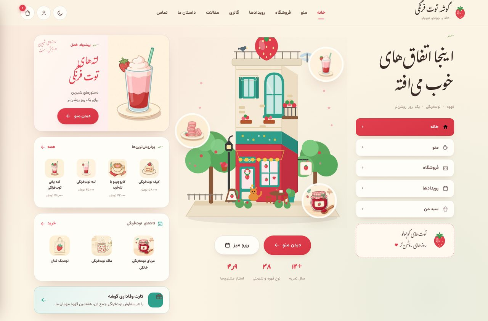
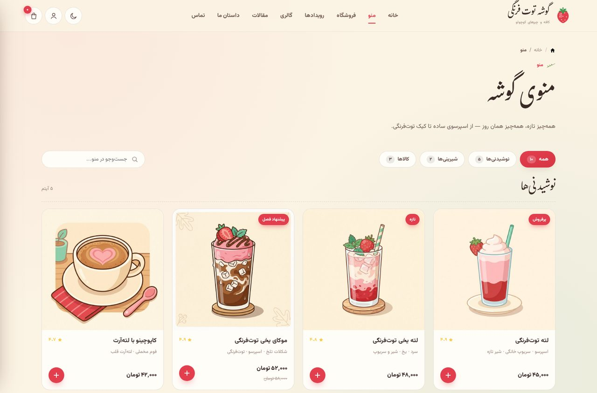
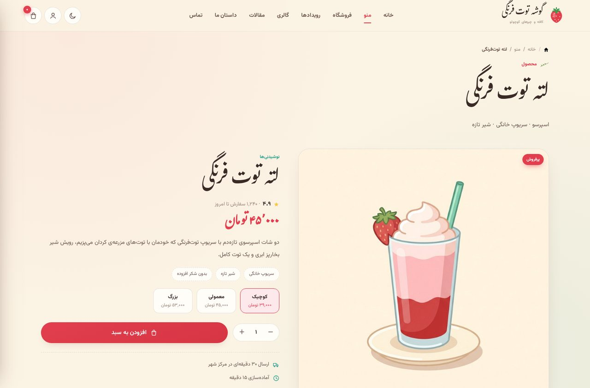
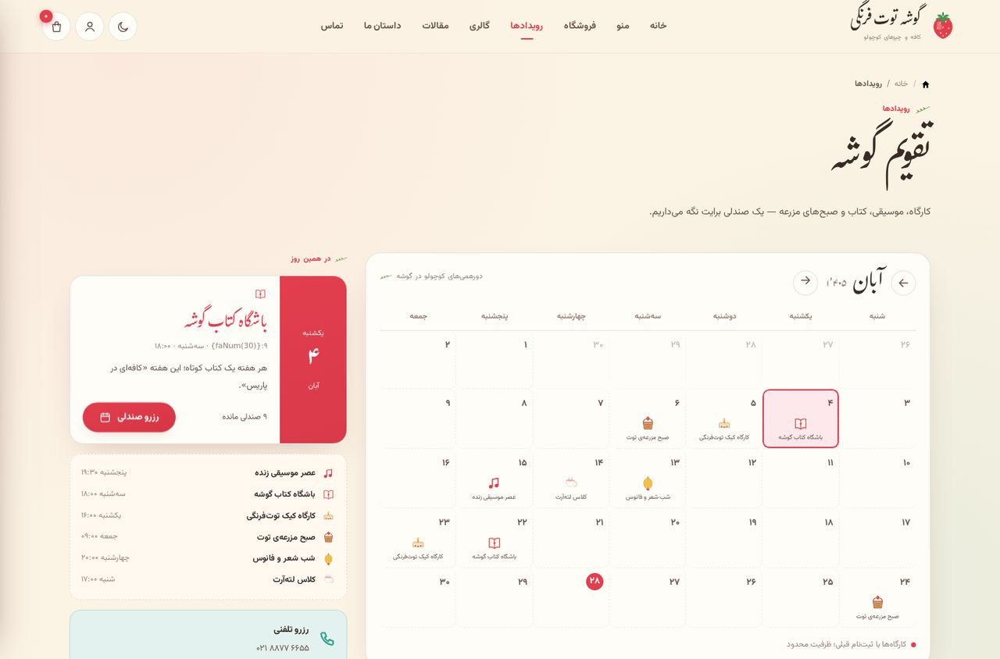
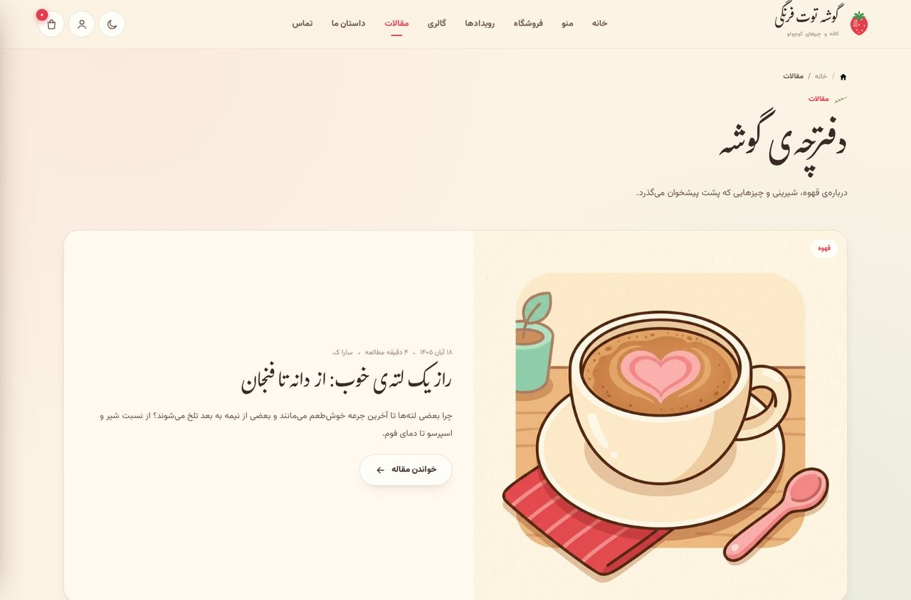
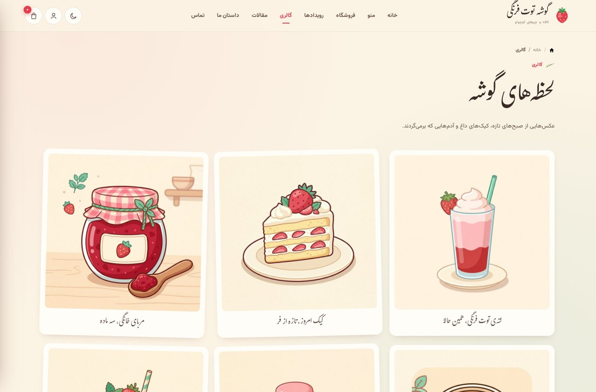
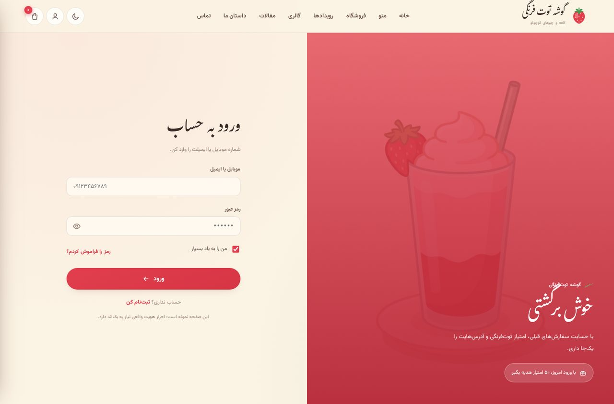
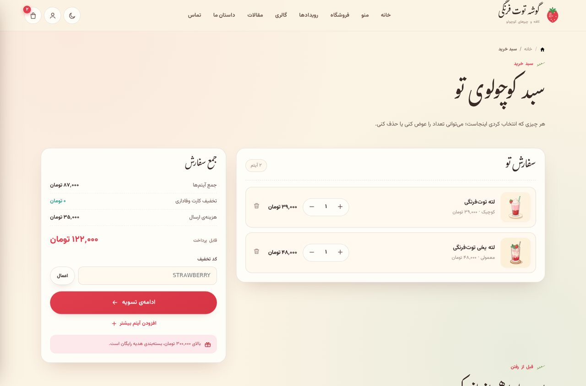
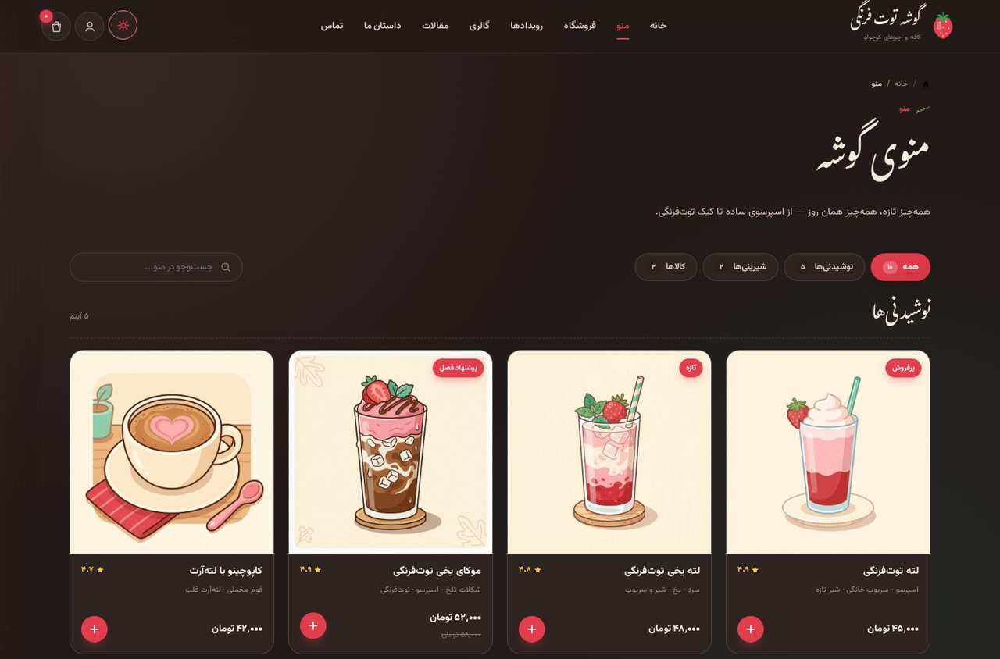
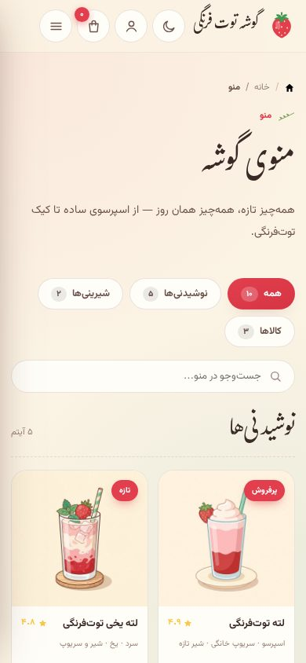

# 🍓 Strawberry Corner — Persian Café Template

**A complete, production-ready, fully RTL café & coffee-shop website template.**
30 static pages · HTML + CSS + vanilla JS · GSAP animations · zero external dependencies · works fully offline.

[فارسی](./README.fa.md) · [Live demo](#quick-start) · [Customization](./docs/CUSTOMIZATION.md) · [Changelog](./CHANGELOG.md)


---

## Preview

| Home | Menu |
|---|---|
|  |  |

| Product | Events (Jalali calendar) |
|---|---|
|  |  |

| Articles | Gallery |
|---|---|
|  |  |

| Login | Cart | Dark mode |
|---|---|---|
|  |  |  |

<p align="center">
  
</p>

---

## Why this template

Most Persian café templates are either a single-page demo or a WordPress theme. This one is a **real multi-page static site** — every page is a separate, linkable HTML file (not an AJAX view swap), so it works on any static host, in offline mode, and behind Iran's national network.

- 🧭 **True multi-page architecture** — 30 independent HTML files, real links, SEO-friendly URLs, shareable deep links.
- 📴 **100% offline** — GSAP, all fonts and all images are local. Zero requests to any CDN.
- 🍓 **Custom illustration set** — 10 hand-generated cartoon product images (760 px, optimised JPEG).
- ✨ **Motion design layer** — GSAP page transitions, scroll reveals, magnetic buttons, 3D tilt, flying add-to-cart, confetti.
- 🧾 **Working client-side commerce flow** — cart, drawer, quantity steppers, coupon, checkout, receipt, persisted in `localStorage`.
- 📅 **Real Jalali calendar** — standard algorithm (no `Intl` quirks), month navigation, event chips, seat reservation with an animated stamp.
- 🌙 **Dark mode**, **RTL-native**, **responsive down to 320 px**, **`prefers-reduced-motion`** respected.
- 🛠 **Data-driven build system** — edit `src/data.py`, run `python3 build.py`, and all 30 pages regenerate with your products, articles and prices.

---

## Pages (30)

| # | Page | File | What's inside |
|---|---|---|---|
| 1 | Home | `index.html` | Hero with café building, season card, bestsellers, goods, feature strip, today's menu, story, articles teaser, gallery teaser, testimonials, CTA |
| 2 | Menu | `menu.html` | Category filters with live counts, instant search, 10 products with photos |
| 3–12 | Product detail | `product-*.html` × 10 | Large photo with mouse-parallax, size selector with live price, quantity, tabs, related products |
| 13 | Shop | `shop.html` | Home goods (jam, mug, tote) |
| 14 | Events | `events.html` | Jalali calendar, month navigation, event chips, day ticket, reserve + stamp |
| 15 | Gallery | `gallery.html` | 10 polaroid frames + keyboard-accessible lightbox |
| 16 | Articles | `articles.html` | Featured article, category filter, search |
| 17–22 | Article reading | `article-*.html` × 6 | Cover, drop cap, pull quote, author box, reading progress bar |
| 23 | Our story | `story.html` | Brand story, values, stats, timeline |
| 24 | Contact | `contact.html` | Contact cards, validated form, illustrated map |
| 25 | Login | `login.html` | Identifier + password, show/hide, inline errors |
| 26 | Register | `register.html` | Full form + password strength meter |
| 27 | Cart | `bag.html` | Items, steppers, remove, coupon, summary, cross-sell |
| 28 | Checkout | `checkout.html` | Delivery form, order summary, order creation |
| 29 | Thank you | `thanks.html` | Order number, receipt, confetti, bunting on the building |
| 30 | 404 | `404.html` | On-brand error page |

---

## Tech stack

| Layer | Choice | Notes |
|---|---|---|
| Markup | Semantic HTML5 | `header`, `nav`, `main`, `article`, `figure`, `footer`, ARIA labels |
| Styling | One hand-written CSS file | Custom properties, `color-mix`, no preprocessor, no framework |
| Scripting | Vanilla ES6 | No jQuery, no React, no bundler — open and read |
| Motion | GSAP 3.12.5 (local copy) | Hands off gracefully if the file is removed |
| Fonts | Vazirmatn 400/500/700/800 + Gulzar | Self-hosted WOFF2, `font-display: swap` |
| Images | 10 generated illustrations | JPEG, 760×760 + 320×320 thumbs |
| Build | Python 3 (stdlib only) | `build.py` + `src/data.py` + `make_data_js.py` |

---

## Project structure

```
strawberry-corner-cafe/
├── index.html … 404.html          # 30 generated pages (do not edit by hand)
├── build.py                       # page generator (layout + partials + data)
├── make_data_js.py                # regenerates js/data.js from src/data.py
├── src/
│   ├── data.py                    # ✏️ edit products, articles, gallery, events, site info
│   ├── _keep_sprite.txt           # SVG symbols (building, strawberry, UI icons)
│   └── _defs.txt                  # SVG patterns & filters
├── css/
│   ├── site.css                   # design system (tokens, components, responsive)
│   └── motion.css                 # motion layer
├── js/
│   ├── libs/gsap.min.js           # local GSAP
│   ├── data.js                    # runtime data (cart lookup, calendar, gallery)
│   ├── app.js                     # cart, fly-to-cart, drawer, Jalali calendar, forms
│   └── motion.js                  # GSAP animations
├── assets/img/                    # product illustrations (+ -sm thumbs)
├── fonts/                         # self-hosted WOFF2
├── docs/
│   ├── CUSTOMIZATION.md
│   ├── PAGES.md
│   ├── DEPLOY.md
│   └── screenshots/
├── .github/workflows/pages.yml    # one-click GitHub Pages deploy
├── CHANGELOG.md · CONTRIBUTING.md · CODE_OF_CONDUCT.md · LICENSE
└── README.md · README.fa.md · REPO.md
```

---

## Quick start

```bash
# 1. clone
git clone https://github.com/<your-username>/strawberry-corner-cafe.git
cd strawberry-corner-cafe

# 2. serve (any static server works)
python3 -m http.server 8000
# → http://localhost:8000
```

No `npm install`, no build step required to view the site. The generated HTML is already in the repo.

> Opening `index.html` directly from the filesystem also works — all paths are relative.

### Rebuild after editing content

```bash
python3 build.py         # regenerates all 30 pages
python3 make_data_js.py  # regenerates js/data.js
```

---

## Customization in 60 seconds

**1 — Products, prices, articles, events** → `src/data.py`

```python
PRODUCTS = [
    dict(id='latte', name='لته توت‌فرنگی', cat='drinks', img='latte.jpg',
         price=45000, old=0, badge='پرفروش', rating=4.9, orders=1240,
         sub='اسپرسو · سریوپ خانگی · شیر تازه',
         desc='…', tags=['سریوپ خانگی'],
         sizes=[('کوچیک', 39000), ('معمولی', 45000), ('بزرگ', 53000)]),
]
```

**2 — Brand, phone, address, designer credit** → `SITE` dict in the same file

```python
SITE = {
    'name': 'گوشه توت‌فرنگی',
    'designer': 'SalarWeb',          # shown in the footer
    'designer_url': 'https://salarweb.ir',
    ...
}
```

**3 — Colors & fonts** → `:root` in `css/site.css`

```css
--red:#E23E4E;  --pink:#F58CA0;  --green:#2FA08C;
--cream:#FBF3E4; --ink:#3A2A26;
--display:'Gulzar'; --body:'Vazirmatn';
```

Full guide: [`docs/CUSTOMIZATION.md`](./docs/CUSTOMIZATION.md) · Adding pages/articles: [`docs/PAGES.md`](./docs/PAGES.md)

---

## Motion & interaction

| Effect | Where |
|---|---|
| Soft page-enter / page-exit transition | Every page |
| Word-by-word hero headline | Home |
| Floating building + floating product bubbles | Home |
| Scroll reveal (IntersectionObserver + GSAP) | All lists & cards |
| Magnetic buttons, 3D tilt cards | Desktop pointers |
| **Flying add-to-cart** (photo arcs into the cart icon, badge pops) | Menu, product, cross-sell |
| Cart drawer slide-in | Every page |
| Calendar cascade + reservation stamp | Events |
| Lightbox with keyboard nav | Gallery |
| Confetti + bunting | Thank-you |
| Reading progress bar | Article pages |
| Falling petals, custom cursor, animated counters | Global |
| `prefers-reduced-motion` → all motion off | Global |

Removing `js/libs/gsap.min.js` degrades gracefully: the site stays fully functional, just without animation.

---

## Offline & Iran national network

- No CDN, no Google Fonts, no analytics, no external images.
- Verified: opening the site with the network disabled produces **0 failed requests**.
- `css/site.css`, `motion.css`, `app.js`, `motion.js` and the WOFF2 fonts are all served from the repository.
- GSAP is vendored at `js/libs/gsap.min.js` (72 KB, MIT).

---

## Accessibility & performance

- Semantic landmarks, skip-friendly heading order, `aria-label` on icon-only buttons, `aria-live` toast.
- Visible `:focus-visible` outlines; keyboard support in the lightbox and mobile menu.
- Contrast-checked text on the cream and dark themes.
- Images carry `width`/`height` and `loading="lazy"`; illustrations are ≤ 80 KB each.
- Total page weight (first load, home): ≈ 300 KB including fonts.

---

## Deployment

Any static host works — it is plain HTML/CSS/JS.

```bash
# GitHub Pages: push to main, the included workflow publishes the root folder
# Netlify / Vercel / Cloudflare Pages: build command = (none), output dir = /
```

Details and per-host notes: [`docs/DEPLOY.md`](./docs/DEPLOY.md)

---

## Browser support

Chrome / Edge 90+, Firefox 90+, Safari 15+ (desktop and mobile). Uses `color-mix()`, CSS nesting-free custom properties and ES6. Graceful fallbacks for `backdrop-filter`.

---

## Roadmap

- [ ] Optional English (LTR) locale
- [ ] Service worker for full PWA offline caching
- [ ] Extra product illustrations (coffee beans, latte art, café interior)
- [ ] Order tracking page with fake statuses

---

## Contributing

Issues and pull requests are welcome — please read [`CONTRIBUTING.md`](./CONTRIBUTING.md) first.
By participating you agree to the [`CODE_OF_CONDUCT.md`](./CODE_OF_CONDUCT.md).

---

## Credits

- **Design & development:** [SalarWeb](https://salarweb.ir)
- **Typography:** [Vazirmatn](https://github.com/rastikerdar/vazirmatn) by Saber Rastikerdar · [Gulzar](https://fonts.google.com/specimen/Gulzar) by Borna Izadpanah
- **Animation:** [GSAP](https://gsap.com/) 3.12.5 (MIT)
- **Illustrations:** generated for this template, free to reuse inside your project

---

## License

[MIT](./LICENSE) © 2025 SalarWeb — free for personal and commercial projects.
If you plan to resell this template as-is, please read the note in [`REPO.md`](./REPO.md#license-note).
